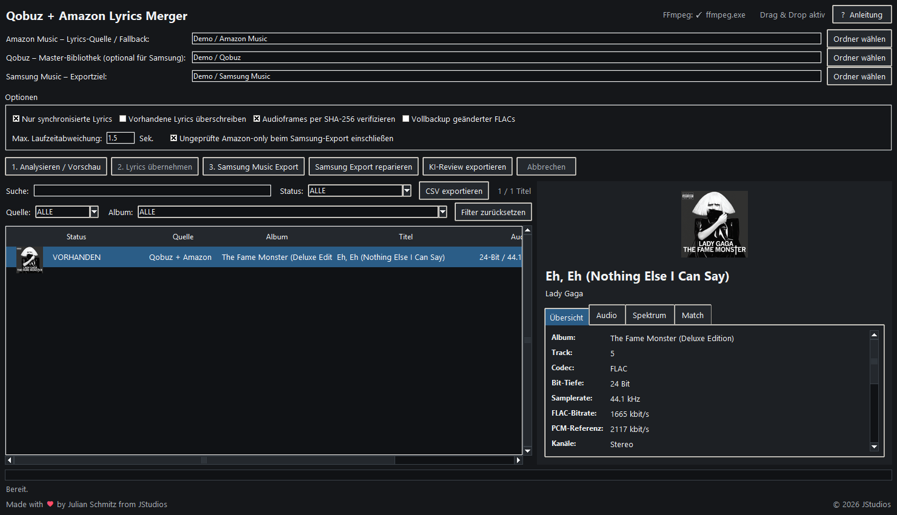
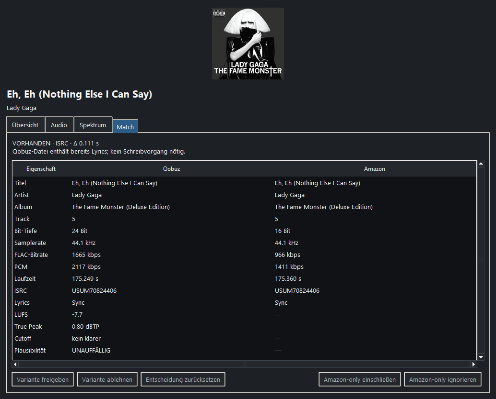
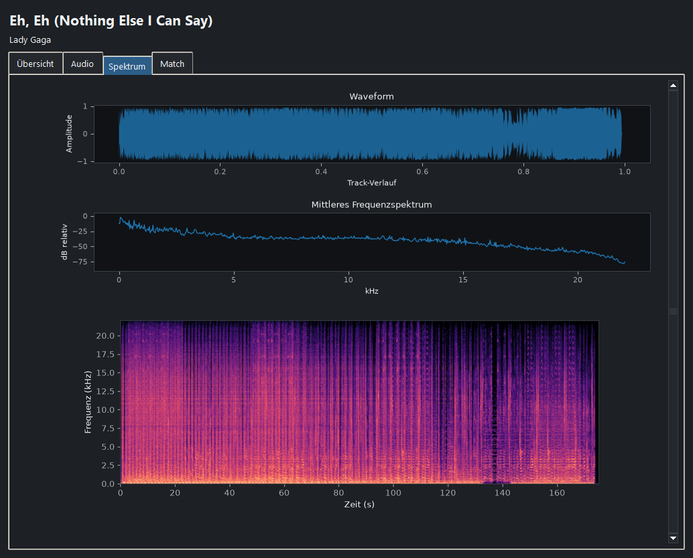

# Lyrics Merge by JStudios

[](https://jstudios.pages.dev/projects/lyrics-merge/)
[](https://www.python.org/)
[](https://docs.python.org/3/library/tkinter.html)
[](https://jstudios.pages.dev/projects/lyrics-merge/)
[](https://jstudios.pages.dev/projects/lyrics-merge/)
[](LICENSE)

**Qobuz als Master. Amazon-Lyrics als Ergänzung. Samsung Music als Ziel.**

[Projektseite](https://jstudios.pages.dev/projects/lyrics-merge/) · [AGPL-3.0-Lizenz](LICENSE) · Version 2.8.1 Final

## Warum ich Lyrics Merge entwickelt habe

Aus meiner Lady-Gaga-Musikbibliothek entstand die Idee: Ich wollte meine eigenen FLAC-Downloads aus zwei Quellen zusammenführen: Qobuz als hochwertige Master-Bibliothek behalten und vorhandene synchronisierte Lyrics aus meinen Amazon-Dateien übernehmen. Anschließend sollte eine separate, für Samsung Music nutzbare Bibliothek mit passenden LRC-Dateien entstehen. Die Musik selbst sollte beim Schreiben der Lyrics-Tags nicht neu encodiert werden.

Aus dieser Anforderung entstand ein Desktop-Werkzeug, das nicht nur Metadaten überträgt, sondern die Zuordnung der Dateien prüft, Varianten zur manuellen Entscheidung vorlegt und technische Audioanalysen ermöglicht.



*Echte Anwendungsansicht aus der Layout-Überarbeitung. Private Pfade wurden durch Beispielpfade ersetzt; keine Musikdateien oder Lyrics enthalten. Das Albumcover erscheint ausschließlich innerhalb der Anwendungsaufnahme.*

## Funktionen

| Bereich | Funktion |
| --- | --- |
| Matching | ISRC als Primärschlüssel, exakter Titel/Interpret als Fallback; Album und Tracknummer zur Variantendiagnose |
| Preview | Status für sichere Matches, vorhandene Lyrics, fehlende Texte, Zeitabweichungen und Varianten |
| Review | Varianten freigeben/ablehnen, Amazon-only separat berücksichtigen, Entscheidungen lokal speichern |
| Tag-Write | Vorhandene Lyrics übertragen, optional nur synchronisierte Lyrics, optional überschreiben |
| Integrität | Optional SHA-256-Prüfung der komprimierten FLAC-Audioframes vor/nach dem Tag-Write; optional Vollbackup |
| Samsung Music | Separate Exportbibliothek, Qobuz bevorzugt, LRC-Sanitizer, Multi-Disc-Fix und Export-Reparatur |
| Audioanalyse | FFmpeg, LUFS/LRA, True Peak, RMS, Crest Factor, Clipping, DC Offset, Waveform, Frequenzspektrum und Spektrogramm |
| Dokumentation | CSV-Preview, optionaler KI-Review-Export als Markdown und JSON |

## Typischer Workflow

1. Lokale Amazon- und/oder Qobuz-Ordner auswählen.
2. **Analysieren / Vorschau:** Dateien zuordnen; noch keine Lyrics schreiben.
3. Review-Fälle kontrollieren, Varianten und Amazon-only-Titel bei Bedarf ausdrücklich bewerten.
4. **Lyrics übernehmen:** Erst nach Kontrolle der Vorschau; nach Möglichkeit Vollbackup und SHA-256-Audioframe-Prüfung aktivieren.
5. **Samsung Music Export:** Separaten Zielordner wählen und die für Samsung Music vorgesehene Bibliothek einschließlich LRC-Dateien erstellen. Export-Reparatur nur bei Bedarf verwenden.

Die Lyrics-Verfügbarkeit wird nach der Dateizuordnung bewertet. Bereits vorhandene Lyrics werden standardmäßig nicht überschrieben. Die Standard-Laufzeittoleranz beträgt 1,5 Sekunden; abweichende Varianten dürfen nicht allein aufgrund einer ähnlichen Laufzeit als identisch gelten.

## Beispiel: Lady Gaga – Eh, Eh (Nothing Else I Can Say)



| Eigenschaft | Qobuz | Amazon |
| --- | ---: | ---: |
| Bit-Tiefe | 24 Bit | 16 Bit |
| Samplerate | 44,1 kHz | 44,1 kHz |
| FLAC-Audiobitrate | 1.665 kbit/s | 966 kbit/s |
| PCM-Referenz | 2.117 kbit/s | 1.411 kbit/s |

ISRC-Match, Laufzeitdifferenz 0,111 s. Die ausgewählte Qobuz-Datei enthält bereits Lyrics, weshalb kein Schreibvorgang erforderlich ist. Die Werte gelten für diese beiden Dateien. Eine höhere Bit-Tiefe ist kein alleiniger Beweis für besseren Klang.



Die Tiefenanalyse visualisiert technische Eigenschaften der dekodierten Audiodaten. Die spektrale Erkennung möglicher Lossy-Cutoffs ist eine Heuristik, kein Beweis einer verlustfreien Herkunft.

## Installation (Windows)

Python mit Tkinter und pip, optional FFmpeg für die Tiefenanalyse. FFmpeg ist nicht enthalten und muss separat aus einer vertrauenswürdigen Quelle installiert und in der Anwendung ausgewählt werden.

```powershell
git clone https://github.com/byJStudios/lyrics-merge.git
cd lyrics-merge
python -m venv .venv
.venv\Scripts\python.exe -m pip install -r requirements.txt
.venv\Scripts\python.exe lyrics_merge.py
```

Alternativ ZIP des Repositorys herunterladen, entpacken und ab Erstellung der virtuellen Umgebung fortfahren.

## Projektstatus und Display-Hinweise

Der veröffentlichte Hauptstand 2.8.1 Final ist ursprünglich für größere Desktop-Displays ausgelegt. Auf kleineren Fenstern können Scrollleisten erforderlich sein. Die Screenshots zeigen eine separat geprüfte Überarbeitung der Fenstergeometrie und des kompakten Layouts. Diese ist noch nicht als stabiler Hauptstand freigegeben.

Beim Start wurde die Anwendung unter Windows getestet. Die Beispielanalyse wurde mit lokal vorhandenen FLACs durchgeführt; die Originaldateien waren danach per SHA-256 unverändert. Vollständige End-to-End-Tests sämtlicher Merge-, Export- und Repair-Sonderfälle sind damit nicht nachgewiesen.

## Datenschutz und Nutzungsgrenzen

- Keine Anmeldung bei Qobuz, Amazon Music oder Samsung Music; keine Downloads von Audio oder Liedtexten. Das Werkzeug verarbeitet vorhandene lokale Dateien.
- Einstellungen, Review-Entscheidungen, Logs und Analyse-/Export-Caches können personenbezogene Pfade und Metadaten enthalten. Diese Dateien bleiben lokal und sind von Git ausgeschlossen.
- KI-Review-Pakete können lokale Dateipfade und kurze Lyrics-Auszüge enthalten. Vor externer Weitergabe unbedingt prüfen und ggf. bereinigen.
- Nur rechtmäßig nutzbare Dateien bearbeiten; vor schreibenden Operationen eine Sicherung anlegen. Audioframe-Integrität ist nicht gleichbedeutend mit vollständiger Metadaten- oder Dateiintegrität.
- Keine Musikdateien, Liedtexte oder FFmpeg-Binaries werden mitgeliefert. Das in den Screenshots gezeigte Albumcover von The Fame Monster ist ein Drittanbieterinhalt, nicht Bestandteil der Softwarelizenz; die Rechte verbleiben bei den jeweiligen Rechteinhabern.

## Lizenz und Unabhängigkeit

Eigener Quellcode: [GNU Affero General Public License, Version 3 (AGPL-3.0-only)](LICENSE). Bei Kombination mit Mutagen (GPL-2.0-or-later, nutzbar unter GPLv3) gelten die jeweiligen Lizenzen und die Kombinationsregelungen in Abschnitt 13 von GPLv3 und AGPLv3. Mutagen wird separat installiert und bleibt unter seiner eigenen Lizenz. Kommerzielle Nutzung ist unter Einhaltung der Lizenz zulässig; bei Weitergabe gelten die Copyleft- und Quellcodepflichten, bei entsprechendem Netzwerkbetrieb einer modifizierten Fassung auch die AGPL-Quellcodepflichten. Andere Abhängigkeiten, Marken, Musik und Inhalte Dritter unterliegen ihren jeweiligen Rechten. Lyrics Merge ist ein unabhängiges JStudios-Projekt und nicht mit den genannten Anbietern verbunden. Frühere Veröffentlichungen werden nicht mehr angeboten; bereits wirksam erteilte Rechte bleiben unberührt.

© 2026 Julian Schmitz / JStudios
